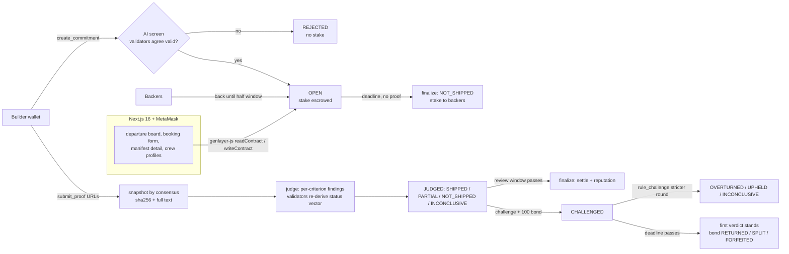

# ProofOfShip

**Say what you'll ship. Prove it shipped.** Builders post a public commitment with a locked checklist of acceptance
criteria, a deadline, the proof type they will deliver and a stake of (non-monetary) points. Backers can back it.
When proof arrives, GenLayer AI validators fetch the proof pages, snapshot them by consensus and judge **every
criterion** MET / NOT_MET / UNCLEAR with verbatim quotes. The verdict (SHIPPED / PARTIAL / NOT_SHIPPED /
INCONCLUSIVE) feeds an on-chain reputation per builder (ship rate, streak). No proof by the deadline = NOT_SHIPPED
automatically. Anyone can challenge a verdict with a bond; challenges have explicit finality rules.

* Live app: https://proofofship.vercel.app
* Contract (GenLayer Studionet, chain 61999): `0x85B483C43FF276901eeCD1D7975a549d07C1cc02`
  ([deploy tx](https://explorer-studio.genlayer.com/transactions/0x53897bfd28345580f091c21c463865137550e409eda362052e7fefe355f16bf1))
* Deployed source fingerprint: `deployments/verification.json` (sha256 of on-chain code = repo commit)
* On-chain end-to-end results with tx links: [`deployments/RESULTS.md`](deployments/RESULTS.md)
* Trust model: [`docs/TRUST_MODEL.md`](docs/TRUST_MODEL.md)

Points have no monetary value. Studionet is a temporary test network.

## Why GenLayer

"Did this builder ship what they promised?" needs someone to **read** a release page or README and decide whether a
natural-language criterion is met. That is not a price feed.

| Approach | What goes wrong |
|---|---|
| Price/data oracle | Oracles deliver numbers from fixed APIs. There is no feed for "the README documents npm install". |
| Plain smart contract | Cannot fetch a web page or interpret text. At best it checks that a URL was submitted. |
| Admin / multisig judge | Works, but a single party decides, can be bribed or simply be slow; no reproducible reasoning. |
| One AI call off-chain | Fast, but whoever runs it controls prompt, page and answer; nobody can verify it was not cherry-picked. |
| **GenLayer** | Several validators independently fetch the same pages, must agree on the exact snapshot (hash + stored text) and on the per-criterion status vector, check every quote deterministically and re-check quotes they did not pick. The verdict is derived by code, stored with its evidence, and challengeable under fixed rules. |

## Architecture



* `contracts/proofofship.py`: the intelligent contract (Python, GenVM). Header `py-genlayer:1jb45aa8...`, `gl.Contract`, `gl.vm.run_nondet_unsafe`.
* `tests/direct/`: 58 direct-mode tests (mocked web + LLM) including adversarial validator tests.
* `scripts/`: deploy, verify deployment fingerprint, Studionet e2e scenarios, browser-originated demo.
* `frontend/`: Next.js 16 + Tailwind 4 + genlayer-js 1.1.8, MetaMask. Pages: departures board (`/`), book a
  commitment (`/new`), manifest detail (`/c/[id]`: criteria, backers, proof snapshots, findings, challenge, timeline),
  crew profile (`/builder/[address]`), crews list (`/builders`), rules & trust (`/rules`).

### Transaction safety in the frontend (`frontend/lib/pos.ts`)

`sendTx` re-checks the active MetaMask account and chain 61999 immediately before signing, persists the tx hash in
localStorage at once, blocks a second submit of the same action while one is unresolved (a repeat call resumes
watching the saved hash), reports success only at **FINALIZED** with a successful leader receipt, and then runs a
verifier that reads the contract to confirm the expected state. New commitment ids come from the transaction's own
return value, never from a pre-read count.

## Run and test

```bash
# contract
python3 -m venv .venv && . .venv/bin/activate && pip install -r requirements.txt
genvm-lint check contracts/proofofship.py
pytest tests/direct -q

# deploy to Studionet (wallet keys in .env, never committed; see .env.example)
npm install
node scripts/deploy.mjs                       # constructor arg: MIN_WINDOW_S (default 60)
node scripts/verify-deployment.mjs --commit <sha> --write

# on-chain e2e (throwaway wallets, Studionet is gasless)
node scripts/e2e.mjs reject|shipped|partial|missed|overturn|inconclusive|uncompleted|overlap|concurrent
node scripts/e2e-changed.mjs submit   # then edit docs/evidence/changed/proof.md on main
node scripts/e2e-changed.mjs judge
node scripts/results.mjs              # writes deployments/RESULTS.md

# frontend
cd frontend && npm install && NEXT_PUBLIC_CONTRACT_ADDRESS=0x85B483C43FF276901eeCD1D7975a549d07C1cc02 npm run dev

# browser-originated demo against the live site (mock EIP-1193 provider, signing happens node-side)
DEMO_URL=https://proofofship.vercel.app node scripts/browser-demo.mjs
```

CI (`.github/workflows/ci.yml`) runs genvm-lint, the direct tests and the frontend type check + build.

## License

MIT
